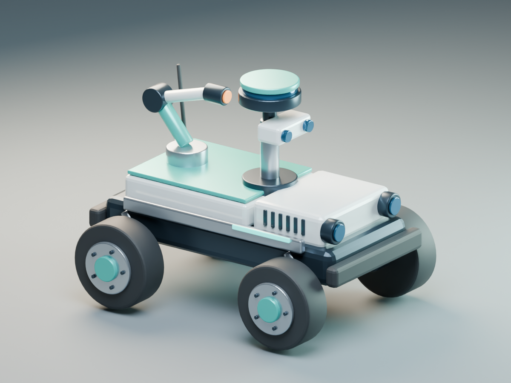
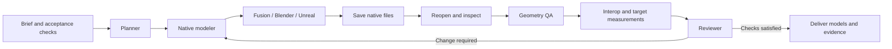

# Studio Agent Bridge

**Native CAD and 3D tools for an agent team: Autodesk Fusion, Blender and Unreal Engine.**

An MCP client can plan a model, execute native Python, inspect real geometry, revise the editable source, and move assets between applications. Every job retains measured evidence and artifact hashes. The included workflow assigns a planner, native modeler, geometry reviewer, interchange specialist and final reviewer.

The language model runs in your MCP client. This repository supplies the native execution layer, role handoffs and durable job state. It works with a single capable agent or a client that delegates to multiple agents; it does not bundle an LLM or require a separate inference API key.



## What actually runs

| Host | Native actions | Editable output | Tested locally |
| --- | --- | --- | --- |
| Autodesk Fusion | Parametric solid construction, archive inspection, parameter revision, export, API documentation and trusted Python | `.f3d`, sketches, dimensions, components and timeline | Fusion 2705.1.30 |
| Blender | Scene construction, inspection, asset import/export, materials, animation, rendering and trusted Python | `.blend`, separate objects and retained modifiers | Blender 5.2.0 LTS |
| Unreal Engine | New project, FBX asset import, scene assembly, materials, lights, camera, sequence, inspection and trusted Python | `.uproject`, `.uasset`, `.umap` | Unreal 5.7.4 |

The verified Blender → Unreal handoff contains **84 meshes and 40,176 triangles**, with measured dimensions of **174 × 135.2 × 135.25 cm** in Unreal. The scene has 90 actors and a four-second camera sequence. Fresh-process inspection confirmed that the camera binding resolves to the saved actor. Unreal validation used NullRHI: GPU rendering, visual equivalence and packaged gameplay were not tested.

The Fusion enclosure has **8 solid bodies, 17 fully constrained sketches and 58 timeline entries**. A width/height change produced a new native model measuring **180 × 100 × 80 mm**, with the original file preserved. Exported F3D files are reopened and compared against seven geometry/history checks before the action is accepted as verified.

These original assets exercise the pipeline. Native scripts allow models beyond the examples, using the installed applications' exposed Python APIs. A script running successfully does not establish that an arbitrary design brief is complete; the client must compare the output with its requirements.

## Quick start

Supported bridge platforms: **macOS and Linux** (POSIX host locks). Fusion requires a supported desktop installation; host availability varies by OS. Python **3.12+** is required. Native applications and their licenses are separate.

```sh
python3.12 -m venv .venv
.venv/bin/python -m pip install -r requirements.lock.txt
.venv/bin/python -m pip install --no-deps -e .
.venv/bin/studio-agent-bridge --workspace "$HOME/StudioAgentWorkspace" status
```

Use a dedicated modeling workspace outside this repository. Generated models, project files, logs and the SQLite job ledger stay there.

Configure your MCP client using the absolute paths for your installation:

```json
{
  "mcpServers": {
    "studio-agent-bridge": {
      "command": "/absolute/path/studio-agent-bridge/.venv/bin/studio-agent-bridge",
      "args": ["--workspace", "/absolute/path/StudioAgentWorkspace", "serve"],
      "env": {"STUDIO_ALLOW_SCRIPTS": "1"}
    }
  }
}
```

`STUDIO_ALLOW_SCRIPTS=1` enables explicitly trusted native Python with the user's application and filesystem privileges. **It is not a sandbox.** Use `0` to retain only the predefined operations. The server itself listens on stdio; Fusion's existing native server must be enabled on loopback. For long native builds, configure a client tool timeout of at least 600 seconds.

Start a conversation in your MCP client:

> Use Studio Agent Bridge to build a parametric sensor enclosure in Fusion. Use a 160 × 100 mm base, a 45 mm housing height, 3 mm walls, four mounting holes, a removable lid and an optical aperture. Preserve editable sketches and dimensions. Reopen the F3D, test a parameter change and compare measured dimensions. Use the planner, modeler and reviewer roles.

Or:

> Use Studio Agent Bridge to create an editable inspection rover in Blender, render it, export the asset to Unreal, create a lit presentation stage and camera sequence, then reopen both native projects and verify the transferred dimensions. Keep the Blender modifiers and report conversion losses.

For a custom project, include dimensions, intended behavior, materials or style, target native files and acceptance checks. The client writes a workspace script and invokes `run_script`; each adapter's entry point is documented below.

## Agent workflow



The MCP server exposes seven tools, two workflow prompts and resources for roles, capabilities and jobs. Jobs have revision checks and a SHA-256 event chain. A per-host process lock prevents two bridge agents from changing the same application at once. Interrupted actions require inspection and reconciliation; they are never blindly replayed.

| Guide | Contents |
| --- | --- |
| [MCP and CLI](docs/mcp.md) | Installation, tools, configuration, ledger, concurrency and recovery |
| [Fusion](docs/fusion.md) | Parametric construction, revisions, native archives and Python entry point |
| [Blender](docs/blender.md) | Scene operations, native scripts, rendering and export validation |
| [Unreal](docs/unreal.md) | Editor projects, FBX handoff, scene/sequence creation and native checks |
| [Validation](docs/validation.md) | Recorded native acceptance results and test boundaries |
| [Agent roles](prompts/) | Prompts for planning, modeling, geometry QA, interchange and review |

## Run a native example without an LLM

```sh
.venv/bin/studio-agent-bridge --workspace "$HOME/StudioAgentWorkspace" job create \
  --name enclosure --host fusion --goal "Create and verify an editable enclosure"

# Replace JOB_ID with the returned id.
.venv/bin/studio-agent-bridge --workspace "$HOME/StudioAgentWorkspace" run \
  --job JOB_ID --revision 1 --action create_demo --parameters '{}'
```

Use returned artifact paths for revisions and handoffs. These commands generate a deterministic acceptance example; natural-language design is performed by the connected client agent.

## Tests

```sh
.venv/bin/python -m pytest -q
.venv/bin/ruff check src tests examples
```

The ordinary suite checks orchestration, paths, failures, revisions, locks and real MCP stdio negotiation. Native integration is separate and needs the applications. Reports distinguish a known failure, a blocked precondition, an unverified execution and measured success. File hashes prove identity, not engineering correctness.

## Scope

This is a local native tooling project, not a CAD kernel, remote rendering service or replacement for engineering review. Fusion feature history remains in F3D; mesh formats do not preserve it. Blender modifiers remain editable in the native blend file and are evaluated during export. Unreal Python automates the editor rather than gameplay runtime. Arbitrary scripts are privileged and should only come from a trusted client.

All bundled models and examples are original synthetic portfolio work. No employer/client assets or proprietary source are included. MIT covers this repository's original code; application licenses remain separate.
