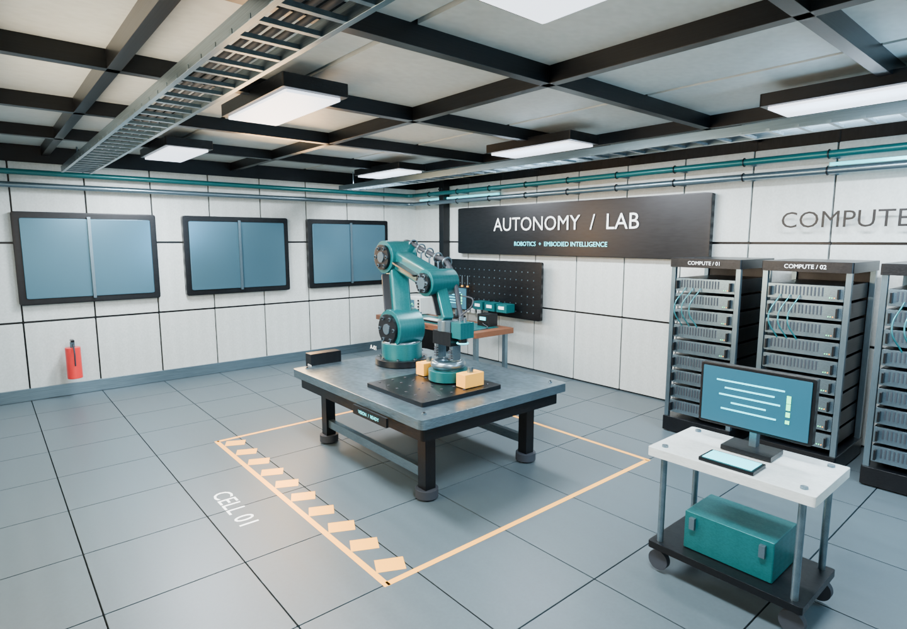
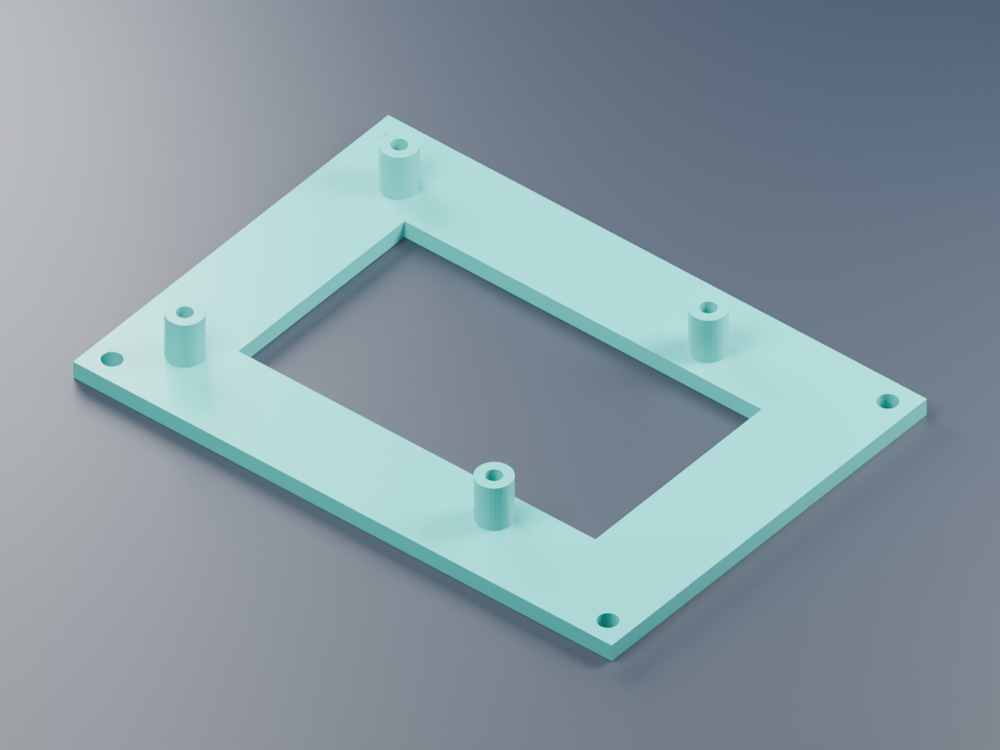
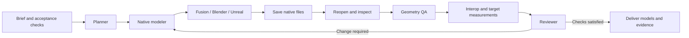

# Studio Agent Bridge

**Native CAD and 3D tools for an agent team: Autodesk Fusion, Blender and Unreal Engine.**

An MCP client can plan a model, execute native Python, inspect real geometry, revise the editable source, and move assets between applications. Every job retains measured evidence and artifact hashes. The included workflow assigns a planner, native modeler, geometry reviewer, interchange specialist and final reviewer.

The language model runs in your MCP client. This repository supplies the native execution layer, role handoffs and durable job state. It works with a single capable agent or a client that delegates to multiple agents; it does not bundle an LLM or require a separate inference API key.



## What actually runs

| Host | Native actions | Editable output | Tested locally |
| --- | --- | --- | --- |
| Autodesk Fusion | Parametric solid construction, archive inspection, parameter revision, export, API documentation and trusted Python | `.f3d`, sketches, dimensions, components and timeline | Fusion 2705.1.30 |
| Blender | Scene construction, inspection, asset import/export, materials, animation, rendering and trusted Python | `.blend`, separate objects and retained modifiers | Blender 5.2.0 LTS |
| Unreal Engine | New project, FBX asset import, scene assembly, materials, lights, camera, sequence, inspection and trusted Python | `.uproject`, `.uasset`, `.umap` | Unreal 5.7.4 |

The original rover handoff contains **84 meshes and 40,176 triangles**, with measured dimensions of **174 × 135.2 × 135.25 cm** in Unreal. That scene has 90 actors and a four-second camera sequence; fresh-process inspection confirmed its saved camera binding. Its original checks used NullRHI. The complete laboratory below additionally exercises real GPU rendering and a substantially larger environment.

The Fusion enclosure has **8 solid bodies, 17 fully constrained sketches and 58 timeline entries**. A width/height change produced a new native model measuring **180 × 100 × 80 mm**, with the original file preserved. Exported F3D files are reopened and compared against seven geometry/history checks before the action is accepted as verified.

These original assets exercise the pipeline. Native scripts allow models beyond the examples, using the installed applications' exposed Python APIs. A script running successfully does not establish that an arbitrary design brief is complete; the client must compare the output with its requirements.

## Applied case: a complete robotics laboratory

**[Explore the detailed environment](https://bernardo-demier-ai-lab.fancy-fly-9200.chatgpt.site/studio-agent-bridge/environment/)** — native render gallery, interactive interior mesh, recorded checks and downloadable day/night Blender scenes with the reusable transfer bundle.

**New native visual pilot:** the [optical inspection station](examples/inspection_workcell/) adds 249 detailed mesh parts to the preserved lab. Matching-camera before/after renders, fresh Blender readback and measured gaps are included. This is a reviewable Blender milestone; its Unreal transfer and human visual acceptance remain pending, and the online environment above still shows the earlier published lab.

The [original laboratory](examples/environments/industrial_lab/) contains complete architecture, an equipped robotics cell, an electronics bench, compute racks, utilities and original PBR surfaces: **1,571 mesh instances, 84 evaluated FBX prototypes, 17 materials, 18 texture maps and 253,920 placed triangles**. Four native cameras and nine lights are retained in the interchange manifest. The editable Blender files preserve source curves, text, separate objects and bevel modifiers.

A chat-directed revision changed the lighting to evening and moved the diagnostic cart by 0.4 m. Both native scenes were reopened. Reversing the edit restored all lights exactly and the 28 cart components within floating-point tolerance. A fresh Blender import of the public GLB preserved mesh count, materials and measured bounds.

Unreal independently reopened the final saved level with **1,571 mesh actors, 84 shared mesh assets, 17 materials, nine lights and four cameras**. All mesh bounds and instance placements passed the transfer checks. A real 1920 × 1080 GPU capture was inspected; the native operation exited successfully. PBR textures and original camera framing transfer, while renderer exposure and shadow appearance remain target-specific. Robot control, navigation baking and packaged gameplay are not part of this case.

The case exposed and fixed a real shared-mesh export failure: the initial GLB silently lost materials. The exporter now uses temporary evaluated prototypes and checks every object's material assignment. Geometry counts alone would not have caught the loss. See [the environment workflow](docs/environments.md) for chat prompts, native evidence and transfer limits.

**Portable publication copies.** The current native download is a separately verified v2 package. Its Blender scenes are resaved and reopened, and its FBX metadata refers to packaged files instead of the author's machine. The publication gate scans every archive member, including decompressed Blender data, and refuses to overwrite an existing version. The [publication record](examples/publication_safety/) distinguishes exact source-geometry comparisons, bounded floating-point differences in evaluated geometry, and a new Unreal transfer check. Original renders and historical execution hashes remain dated evidence; this follow-up makes no new appearance or performance claim. See the [design and limits](docs/publication-safety.md).

## Reliability case: recovering interrupted native actions

**[Explore the recovery lab](https://bernardo-demier-ai-lab.fancy-fly-9200.chatgpt.site/studio-agent-bridge/recovery/)** — step through recorded process interruptions, preserved effects and explicit reconciliation. The Python bridge and SQLite are real; these fault-injection traces use synthetic host adapters, not native modeling applications.

A durable action intent is published before run-directory allocation or native dispatch. Inspection uses a consistent database snapshot, avoiding false event-chain failures when another process commits concurrently. The new `studio_recovery_report` tool explains unresolved intent and preserved run directories without launching an editor or changing state. Recovery does not automatically replay an action or infer that an external process is idle.

See the [recovery design, threat model and reproduction guide](docs/recovery.md) and the [executable experiment](examples/recovery/). Native geometry evidence remains in the separate cases above and below.

## Reliability case: editing the scene version you reviewed

**[Compare source-bound native revisions](https://bernardo-demier-ai-lab.fancy-fly-9200.chatgpt.site/studio-agent-bridge/source-binding/)** — compare matching-camera Blender renders, inspect the reviewed source identity and follow the recorded Unreal handoff.

An existing-scene Blender `run_script` request now requires `expected_source_sha256`. The adapter hashes the bytes copied into its run-local snapshot and rejects a stale source before launching Blender. A valid edit opens the preserved snapshot, saves a separate scene, and checks the source and snapshot independently after execution. Supplying the hash also enables this protection for inspection, rendering, export and imports into an existing scene.

The recorded case rejected a stale hash with **zero Blender launches**, then moved **28 cart components by 0.25 m** while preserving the original source and **1,571 mesh instances**. Fresh Blender processes confirmed the saved positions and matching-camera renders. Unreal reopened the transferred level with **1,571 mesh actors, 82 reusable mesh assets and 17 materials**. The initial NullRHI build crashed in viewport actor placement; an explicit GPU-mode retry in a new destination and a separate reopen passed. This run verifies target structure, not Unreal appearance. The failed attempt remains in the public evidence.

Only the `.blend` bytes are pinned. The native gate rejects known unsupported external resources before running the edit script; supported resources must be packed. Read-only snapshot permissions are a cooperative safeguard, not OS immutability or a Python sandbox. Other scene-consuming actions remain available without a pin for compatibility and report that weaker mode. See the [design and threat model](docs/source-binding.md) and [native reproduction case](examples/source_binding/).

**Follow-up: reject the known Unreal crash before launch.** The adapter now blocks manifest-driven `build_scene` with NullRHI on macOS with detected Unreal 5.7.4. Two real requests launched no subprocesses and preserved the native project tree; the Engine still recorded their lifecycle. An explicitly selected GPU build and fresh inspection of the original public lab verified 1,571 mesh actors, 84 shared mesh assets, 17 materials, nine lights and four cameras. This separate run captured no Unreal image. [Explore the five recorded actions](https://bernardo-demier-ai-lab.fancy-fly-9200.chatgpt.site/studio-agent-bridge/source-binding/#unreal-preflight), [reproduce them](examples/unreal_preflight/), or read the [compatibility decision and limits](docs/unreal-preflight.md).

## Applied case: a board mounting fixture

**[Open the browser demo](https://bernardo-demier-ai-lab.fancy-fly-9200.chatgpt.site/studio-agent-bridge/)** — explore the actual exported 3D mesh, compare verified measurements, inspect the source evidence and download the native case. The browser visualizes geometry; parametric CAD editing remains in Fusion.

The [Raspberry Pi 5 open tray case](examples/fusion/rpi5-open-tray/) starts from an official public mechanical drawing and creates an original parametric fixture. Two native configurations were built, independently reopened and measured: **101 × 72 × 11 mm** and **109 × 80 × 14 mm**, each with one connected solid, 15 fully constrained sketches and 43 timeline entries. BRep checks verify bore centres, diameters, full depths and open relief. The actual exported mesh was transferred to Blender, scale-checked and rendered.



The case includes reproducible scripts, source attribution, measured evidence and a parameter revision. It demonstrates a useful bench-fixture workflow; physical board fit, material/process suitability and production tolerances remain untested. The source itself labels its dimensions approximate reference data.

## Quick start

Supported bridge platforms: **macOS and Linux** (POSIX host locks). Fusion requires a supported desktop installation; host availability varies by OS. Python **3.12+** is required. Native applications and their licenses are separate.

```sh
python3.12 -m venv .venv
.venv/bin/python -m pip install -r requirements.lock.txt
.venv/bin/python -m pip install --no-deps -e .
.venv/bin/studio-agent-bridge --workspace "$HOME/StudioAgentWorkspace" status
```

Use a dedicated modeling workspace outside this repository. Generated models, project files, logs and the SQLite job ledger stay there.

Configure your MCP client using the absolute paths for your installation:

```json
{
  "mcpServers": {
    "studio-agent-bridge": {
      "command": "/absolute/path/studio-agent-bridge/.venv/bin/studio-agent-bridge",
      "args": ["--workspace", "/absolute/path/StudioAgentWorkspace", "serve"],
      "env": {"STUDIO_ALLOW_SCRIPTS": "1"}
    }
  }
}
```

`STUDIO_ALLOW_SCRIPTS=1` enables explicitly trusted native Python with the user's application and filesystem privileges. **It is not a sandbox.** Use `0` to retain only the predefined operations. The server itself listens on stdio; Fusion's existing native server must be enabled on loopback. For long native builds, configure a client tool timeout of at least 600 seconds.

Start a conversation in your MCP client:

> Use Studio Agent Bridge to build a parametric sensor enclosure in Fusion. Use a 160 × 100 mm base, a 45 mm housing height, 3 mm walls, four mounting holes, a removable lid and an optical aperture. Preserve editable sketches and dimensions. Reopen the F3D, test a parameter change and compare measured dimensions. Use the planner, modeler and reviewer roles.

Or:

> Use Studio Agent Bridge to create an editable inspection rover in Blender, render it, export the asset to Unreal, create a lit presentation stage and camera sequence, then reopen both native projects and verify the transferred dimensions. Keep the Blender modifiers and report conversion losses.

For complete environments:

> Create a detailed industrial robotics laboratory in Blender: 12 × 9 m, an equipped robotics cell, electronics benches, server racks and utilities. Model the architecture, assemblies, cable routes, vents, fittings and props; use original PBR materials, practical lights and three interior camera views. Inspect the renders, correct unfinished details, then transfer the complete scene to Unreal and reopen both native files. Keep everything editable and preserve versions for changes through chat.

Then continue naturally:

> Keep the layout and objects. Create an evening lighting revision, bring the camera closer to the robot and save it separately from the daytime scene.

The [environment workflow](docs/environments.md) defaults to **high detail**. The chat agent handles planning, native scripts, visual review and revisions. The MCP server validates the structured brief and executes host actions; the user does not need to write scripts. Blockouts remain intermediate work, and numeric geometry checks do not substitute for visual inspection.

For a custom project, include dimensions, intended behavior, materials or style, target native files and acceptance checks. The client writes a workspace script and invokes `run_script`; each adapter's entry point is documented below.

## Agent workflow



The MCP server exposes nine tools, three workflow prompts and resources for roles, capabilities and jobs. Jobs have revision checks and a SHA-256 event chain. A per-host process lock prevents two bridge agents from changing the same application at once. Interrupted actions require inspection and reconciliation; they are never blindly replayed.

| Guide | Contents |
| --- | --- |
| [MCP and CLI](docs/mcp.md) | Installation, tools, configuration, ledger, concurrency and recovery |
| [Fusion](docs/fusion.md) | Parametric construction, revisions, native archives and Python entry point |
| [Blender](docs/blender.md) | Scene operations, native scripts, rendering and export validation |
| [Unreal](docs/unreal.md) | Editor projects, FBX handoff, scene/sequence creation and native checks |
| [Detailed environments](docs/environments.md) | Chat briefs, complete Blender scenes, Unreal transfer, visual review and revisions |
| [Source-bound revisions](docs/source-binding.md) | Reviewed scene hashes, preserved snapshots, packed-resource limits and native edit evidence |
| [Portable publication](docs/publication-safety.md) | Versioned native copies, metadata checks, model comparisons and preserved historical evidence |
| [Validation](docs/validation.md) | Recorded native acceptance results and test boundaries |
| [Agent roles](prompts/) | Prompts for planning, modeling, geometry QA, interchange and review |

## Run a native example without an LLM

```sh
.venv/bin/studio-agent-bridge --workspace "$HOME/StudioAgentWorkspace" job create \
  --name enclosure --host fusion --goal "Create and verify an editable enclosure"

# Replace JOB_ID with the returned id.
.venv/bin/studio-agent-bridge --workspace "$HOME/StudioAgentWorkspace" run \
  --job JOB_ID --revision 1 --action create_demo --parameters '{}'
```

Use returned artifact paths for revisions and handoffs. These commands generate a deterministic acceptance example; natural-language design is performed by the connected client agent.

## Tests

```sh
.venv/bin/python -m pytest -q
.venv/bin/ruff check src tests examples
```

The ordinary suite checks orchestration, paths, failures, revisions, locks and real MCP stdio negotiation. Native integration is separate and needs the applications. Reports distinguish a known failure, a blocked precondition, an unverified execution and measured success. File hashes prove identity, not engineering correctness.

## Scope

This is a local native tooling project, not a CAD kernel, remote rendering service or replacement for engineering review. Fusion feature history remains in F3D; mesh formats do not preserve it. Blender modifiers remain editable in the native blend file and are evaluated during export. Unreal Python automates the editor rather than gameplay runtime. Arbitrary scripts are privileged and should only come from a trusted client.

All bundled fixture geometry and example code are original portfolio work. Third-party numerical reference facts are attributed in the applied case. No employer/client assets or proprietary source are included. MIT covers this repository's original code; application licences and source notices remain separate.
