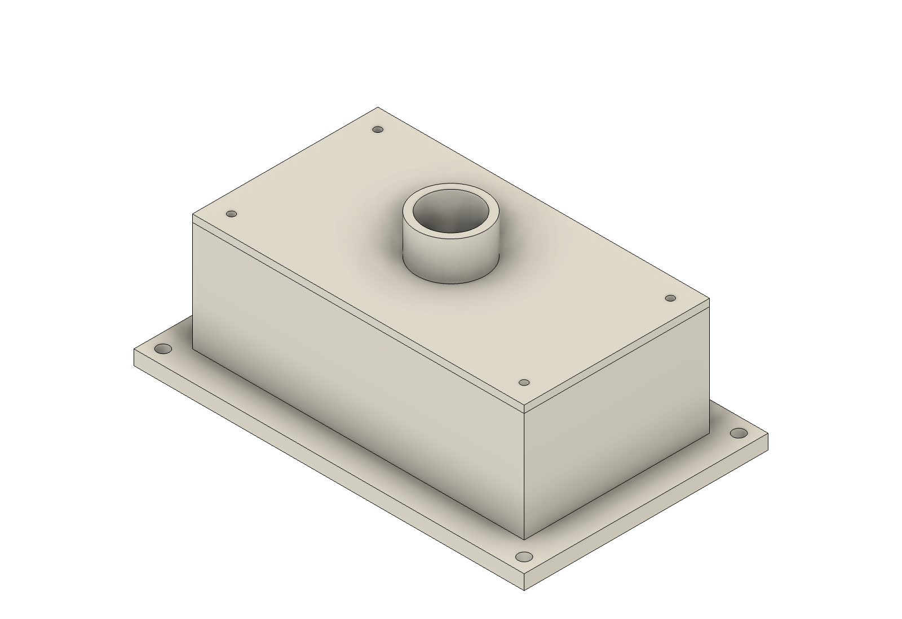

# Native acceptance record

Observed on macOS on **2026-10-19**. This record separates orchestration tests from application-backed results. Full machine logs and working files remain in the local workspace; these public reports contain original synthetic geometry measurements and artifact hashes.

## Automated tests

**81 tests passed; one opt-in Blender native test was skipped in the ordinary suite.** Ruff passed across source, tests and examples. The Blender native integration was separately executed successfully against the installed application, along with the targeted native operations below. The project wheel was built and inspected for all host scripts and role prompt resources.

The ordinary suite covers real MCP stdio negotiation/tool calls, revision conflicts, event-chain consistency, source/artifact changes, path and symlink boundaries, script opt-in, stale evidence, concurrent native actions, interrupted subprocesses, unresolved outcomes, export failures, Unreal object-reference handoffs and stable log snapshots. Mocked adapter tests are not counted as application geometry tests.

## Fusion

- Actual MCP stdio calls dispatched through the bridge to Fusion **2705.1.30**.
- Created **8 solid bodies**, **17 fully constrained sketches**, **12 user parameters** and **58 timeline entries**.
- Initial bounds: **160 × 100 × 70 mm**.
- Changed width and housing height through `edit_parameters`: **180 × 100 × 80 mm**.
- Executed a trusted native Python revision increasing lens length: **180 × 100 × 88 mm**.
- Every final F3D was reopened; body count, history count, health, parameter expressions, positive solids, bounds and constraints matched.
- Original archives were preserved; SHA-256 manifest checks passed. Version-specific API documentation was retrieved through MCP.

[Recorded Fusion measurements](../examples/fusion/native-verification.json)

## Blender

- Blender **5.2.0 LTS** created an editable rover and studio scene.
- **84 asset meshes**, 84 retained bevel modifiers, 9 materials and keyed lidar rotation. The studio floor adds one further mesh to the native scene.
- Asset bounds: approximately **1.740 × 1.352 × 1.3525 m**.
- Native reopen and separate GLB/FBX import processes checked counts and dimensions.
- A custom Python revision raised the mast **0.15 m**, changing height to **1.5025 m** while preserving the input hash.
- Original and revised images were rendered and visually inspected. Saved render settings were independently checked on reopening.
- The native scene was also inspected through the actual MCP server.

[Recorded Blender measurements](../examples/blender/observed-native-proof.json)

## Unreal and cross-application handoff

- Unreal **5.7.4** created a real native project and imported Blender's FBX.
- **84 StaticMesh assets**, **40,176 triangles**, measured bounds **174 × 135.200004 × 135.250009 cm**.
- The saved level contains **90 actors**, native materials, three lights and a cine camera.
- The **24 fps / 96 frame** sequence has 9 transform channels, 18 keys and a camera-cut track.
- A new editor process reopened the saved assets/map and resolved both camera bindings to the persisted camera actor.
- Actual MCP `inspect` succeeded. A subsequent artifact query verified the native files and frozen process-log snapshot against their hashes.

[Recorded Unreal measurements](../examples/unreal/native-verification.json)

## Failures caught during real execution

- Fusion sketch constraints were refined until all sketches were fully constrained rather than merely dimensioned.
- Unreal's FBX warning logger attempted to open a Slate window in headless mode when smoothing groups were absent. Explicit face-smoothing export resolved that import failure.
- A camera bound before the level was saved referred to an Untitled world and failed after restart. Saving the world before binding resolved it.
- Unreal helper processes continued appending to inherited stdout after editor exit. The manifested log is now a frozen snapshot; the changing diagnostic log is excluded from the manifest.
- Native Unreal object paths returned by inspection can now be passed back as input, with strict package/suffix validation.

## What these checks do not establish

This is one original native fixture per workflow, not a reliability benchmark for arbitrary briefs. The Fusion enclosure and Blender rover have no engineering certification, load analysis or manufacturing release. Interchange checks do not prove identical shaders, every local transform or rig behavior. Unreal execution used NullRHI, so GPU rendering, Lumen/Nanite output, animation appearance, packaged gameplay and performance are unverified. The client must create acceptance checks for each new project and inspect its actual outputs.
