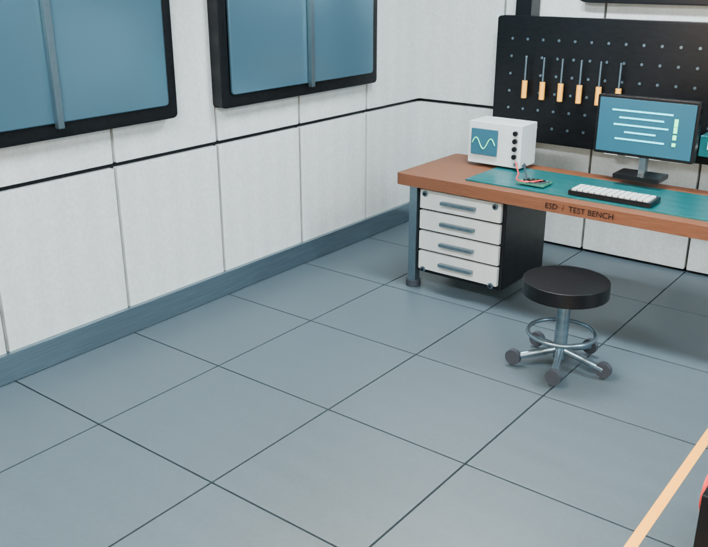
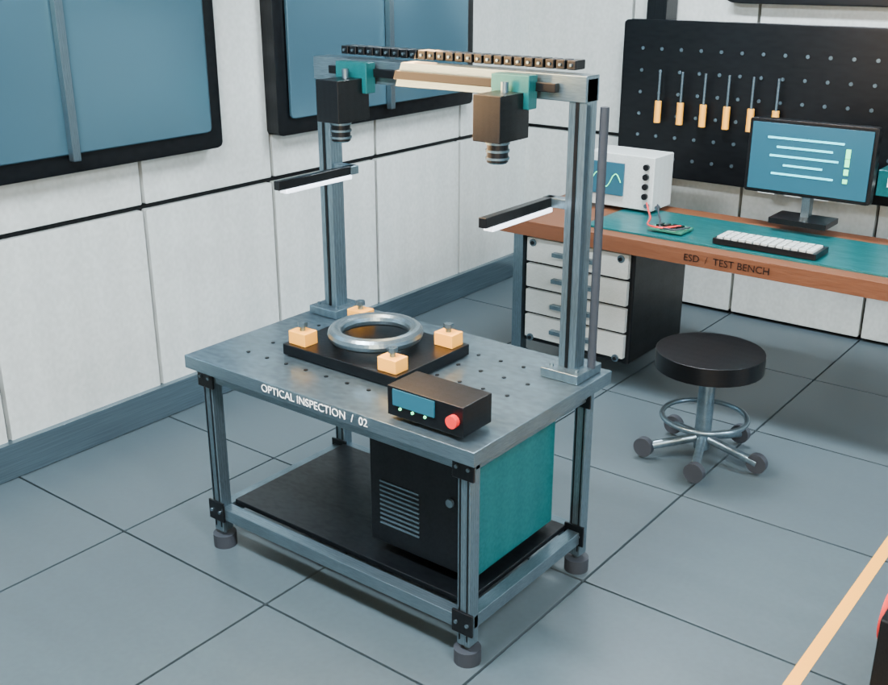

# Source-bound optical inspection station: native visual pilot

A chat-directed addition to the existing industrial lab, executed with the real Blender adapter. The connected client authored the modelling script; the bridge provided source-hash checks, durable job state, native execution and saved-file evidence. There is no autonomous inference in the server.

This is a **Blender visual pilot**, not a completed Blender-to-Unreal revision. It is intentionally published with matching-camera images so the composition can be reviewed before expanding the environment or claiming transfer quality.

## Before and after

Same camera, lighting, resolution and Cycles settings. PNG metadata was removed without changing RGB pixels.

| Reviewed baseline | Added station |
| --- | --- |
|  |  |

The station contains individually named frame members, slots, brackets, levelling feet, fasteners, fixture sockets and clamps, an original ring workpiece, dual camera housings and lenses, illuminator mounts, cable-chain links, a cabinet with ventilation, an HMI prop and signage. Repeated cylindrical parts share native mesh data. Existing packed materials are reused.

The first render exposed illuminators without a complete connection to the gantry. The second revision adds two cross-brackets. Both native attempts remain preserved locally; the images above show the corrected version.

## Reproduce

From the repository root, with the documented development environment and Blender installed:

```bash
.venv/bin/python examples/inspection_workcell/run_example.py --output /path/to/new-empty-run
```

This executes trusted Python with Blender's user privileges. It does not download assets, run an LLM, or call a paid API. Use a new empty folder for every run; the example refuses to replace prior evidence. Its source is the exact reviewed `industrial-lab-native-v2.zip` scene already in this repository. A changed scene hash is rejected before preparation. Never substitute a newly computed hash without reviewing a different input.

The runner performs three distinct native actions: baseline render, additive revision and fresh-process readback. It saves a local `state.json` with job IDs, action records, native artifact hashes and output paths. Input bytes remain unchanged. The `verify_station.py` script can be dispatched in a further `run_script` action with the newly saved scene's reviewed hash for independent geometry readback; it imports no construction code.

Raw native output/logs may contain local paths. They are not approved public downloads: run the separate [publication-safety workflow](../publication_safety/) before distributing native files.

## Observed evidence and limits

See [observed-native-proof.json](observed-native-proof.json) for measured counts, hashes, correction history and validation scope. The original 1,571 mesh records retain the same measured positions, base vertices, polygon indices and material-slot assignments across baseline, revision and fresh reopen. The addition has 249 mesh objects. These checks do not establish complete Blender-file equivalence, modifier invariance, appearance equivalence or physical performance.

The optical devices, control panel and workpiece are visual geometry. There is no camera sensor model, optical inspection algorithm, robot controller, kinematics or electrical/safety certification. The fixture sockets are surface details, not subtractive machining features. Human visual acceptance is pending. The revised environment has not yet been imported into Unreal; the earlier lab's transfer evidence must not be attributed to this version.

## Next acceptance gate

Review this native sample, then add wide and close views and complete the cable/utility integration. Measure occupied space and clearances, export the exact revised bundle, import into a new Unreal GPU project and freshly reopen it. A real Unreal image is required before claiming visual transfer. Preserve every earlier scene and report failures as well as successful checks.

## Provenance and security boundary

All added geometry, labels and assembly design are original synthetic examples under the repository's MIT license. No external meshes or proprietary parts were used. Source pinning and output-directory isolation reduce accidental overwrites and stale edits; trusted script execution is not a sandbox, and mesh counts do not certify safety.
