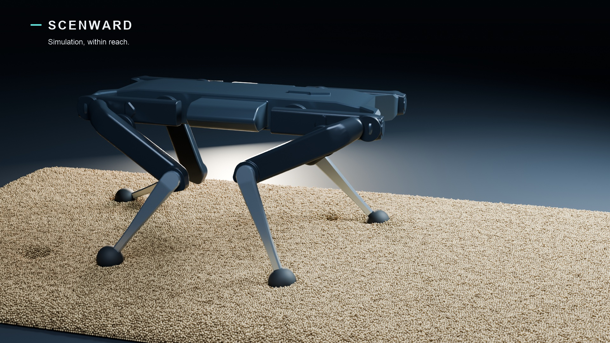

# Solo12 granular simulation on Apple Silicon

**An open-source robot, 961,191 simulated grains, and a local simulation-to-video workflow.**

**Windows NVIDIA / AMD:** [installation, GPU selection and video workflow](docs/windows.md). NVIDIA uses CUDA for simulation and CUDA/OptiX for rendering; AMD uses Vulkan for simulation and HIP for rendering. GPU routes are implemented; native Windows GPU execution and performance still need hardware validation. CPU installation and simulation are covered by Windows CI.

[](https://github.com/demier-demier/studio-agent-bridge/releases/download/solo12-granular-v1/Scenward-Solo12-Apple-Silicon.mp4)

**[Watch or download the 16-second video](https://github.com/demier-demier/studio-agent-bridge/releases/download/solo12-granular-v1/Scenward-Solo12-Apple-Silicon.mp4)** · [Release and checksums](https://github.com/demier-demier/studio-agent-bridge/releases/tag/solo12-granular-v1) · [Architecture and limits](docs/architecture.md) · [Recorded measurements](evidence/recorded-run.json)

This is the source for Scenward's Solo12 walking video. MuJoCo integrates the free-body robot and its twelve actuated joints. A Taichi/Metal discrete-element solver computes spherical particle contacts and exchanges foot-contact forces and torques with the robot. Blender renders the recorded positions. The controller applies joint torques; the robot's base is not moved along a keyframed path.

The example is self-contained within this directory. It does not require an MCP client or model API. Simulation backends are CPU, Apple Metal, NVIDIA CUDA and Vulkan (including supported AMD GPUs). Each GPU route requires its matching working driver. The recorded full run used Metal on an Apple Silicon Mac; a small CPU preset supports installation and integration checks on other machines. This is classical control and physics code, **not a Cosmos/Newton port or a learned locomotion policy**.

## Run a small example first

Use Python 3.12. From a fresh clone:

```sh
git clone https://github.com/demier-demier/studio-agent-bridge.git
cd studio-agent-bridge/examples/solo12_granular
python3.12 -m venv .venv
.venv/bin/python -m pip install -r requirements.txt
.venv/bin/python check_granular.py --backend cpu
.venv/bin/python simulate.py --preset smoke --arch cpu --output runs/smoke
```

The smoke run exercises initialization, particle contacts, robot integration and cache output. It is not the full walking sequence or a validation of locomotion performance. Output directories must be new, so a failed or earlier run is not silently overwritten. Windows users can use `.venv\Scripts\python.exe` instead of `.venv/bin/python`.

## Reproduce the full simulation

```sh
.venv/bin/python check_granular.py --backend metal
.venv/bin/python simulate.py --preset video --arch metal --output runs/video
.venv/bin/python locomotion/audit_run.py runs/video
.venv/bin/python measure_tracks.py runs/video
```

The video preset pins the geometry and control settings used in the published run: 3 mm diameter grains, nine layers, a 1.6 × 0.68 m bed, the smooth feedback crawl, 0.08 m/s requested speed, 0.6 s step time, and 0.008 m lateral shift. The recorded particle array alone is approximately **2.8 GB**. Keep at least 8 GB free for simulation data; a complete render needs additional space for hundreds of images. On the recorded 24 GB M4 Pro, eight seconds of dynamics took **550.53 seconds**, plus **15.70 seconds** of settling computation. These are observed timings, not a real-time or cross-hardware performance claim.

CPU execution is also selectable with `--arch cpu`, but the million-particle case has not been timed on CPU. Backend selection is explicit; Metal is not silently substituted when unavailable. Parallel floating-point accumulation can change the exact trajectory. Reproduction means rerunning the documented model and checks, not a promise of bit-identical particle arrays.

## Render and assemble the video

Install Blender and FFmpeg separately. The recorded render used Blender 5.2.0 LTS with Cycles Metal. Run these commands from this example directory, with `blender` and `ffmpeg` available on your PATH:

```sh
blender --background --python-exit-code 1 --python cinema/render_scene.py -- runs/video --shot hero --start 24 --end 240 --samples 48
blender --background --python-exit-code 1 --python cinema/render_scene.py -- runs/video --shot contact --start 108 --end 198 --samples 48 --grain-subdivision 2
blender --background --python-exit-code 1 --python cinema/render_scene.py -- runs/video --shot trail --still 240 --samples 64 --grain-subdivision 2
.venv/bin/python audio/download_music.py --output runs/video/DST-MindStream.mp3
.venv/bin/python edit_video.py --run runs/video --output runs/video-edit --music runs/video/DST-MindStream.mp3 --hardware-label "Apple M4 Pro"
```

On macOS, Blender's executable is normally `/Applications/Blender.app/Contents/MacOS/Blender`. Use that quoted path in place of `blender` when it is not on your PATH. Pass `--cpu` to the renderer for CPU rendering. The renderer reads numeric caches and the packaged robot geometry; it does not invent robot or particle motion. The editor combines the continuous walk, a replay from the contact camera, a final-state track view and an English closing card. The track view includes a small camera-style crop of a still frame.

The renderer also accepts `--device CPU|METAL|CUDA|OPTIX|HIP` and `--list-devices`. GPU requests fail if the requested backend has no usable matching device; they do not silently fall back to CPU. Follow the [Windows guide](docs/windows.md) for PowerShell paths and vendor-specific commands.

Use the hardware label of the machine that actually ran your simulation. Omit `--music` for foley-only output, and use `--font` / `--bold-font` if the automatic local font search does not find a suitable font. Recorded sand footsteps and music have CC0 sources; the sound design is synchronized editorial audio, not computed acoustics. See [third-party notices](THIRD_PARTY_NOTICES.md). Fonts and renderer versions can change the exact typography and image appearance of a regenerated video.

## What was measured

| Quantity | Recorded value |
| --- | ---: |
| Represented particles | 961,191 |
| Simulated time label | 8.0 s |
| Robot forward travel | 0.578 m |
| Lateral displacement | −0.00312 m |
| Maximum body tilt after startup | 4.34° |
| Maximum recorded actuator torque | 1.582 N·m |
| Independent trajectory checks | 18 passed |
| Analytic contact checks | 12 passed on CPU; 12 passed on Metal |
| Final video | 16 s, 1920 × 1080, 30 fps |

The [evidence directory](evidence/) records the measured run, checks and video hash. These are dated results from the video-producing run. Source hashes from that run identify historical files; the public package includes portability and CLI changes. Its release checks are reported separately rather than presented as a new full-scale run.

## Interpretation and boundaries

This is a **shallow granular layer over a rigid substrate**, not calibrated deep sand. Approximately **92.3% of the sampled vertical support came from the rigid substrate** and 7.7% from the granular layer. The support ratio is a sampled diagnostic, not a high-rate ground-truth measurement. Only the foot pads exchange particle forces; the chassis and leg meshes do not collide with particles.

Grains use translational spherical DEM without angular grain dynamics, rolling resistance, cohesion or a calibrated soil law. The model has experimental 20 mm foot pads and a classical feedback crawl. It has not been validated on robot hardware or compared with NVIDIA simulation platforms. The recorded loop labels a frame by its pre-step time but saves the post-step state, a documented **+1 ms** offset retained for reproduction.

Passing the included checks establishes bounded numerical and integration behavior. It does not establish soil fidelity, general robot safety, production readiness or platform equivalence.

## Contributing and license

Useful contributions include calibrated granular models, angular grain dynamics, broader robot–terrain coupling, controller evaluations and measured performance improvements that preserve the model. Include a reproducible command, machine/backend details, before/after results and a description of any changed physics assumptions.

Original code and graphics follow the repository's [MIT license](../../LICENSE). Solo12 geometry and description come from the **Open Dynamic Robot Initiative** under BSD-3-Clause; the exact license and upstream commit are retained. Audio sources are CC0. See [THIRD_PARTY_NOTICES.md](THIRD_PARTY_NOTICES.md) for attribution and scope.
