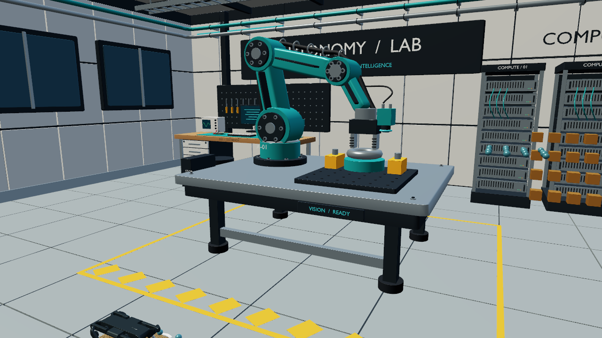

# Live physics and Blender environments

The Rust application now **computes new particle and robot states**, rather than displaying a recorded future. It integrates 961,191 individual 3 mm grains through wgpu compute on Metal and couples them to native articulated-body dynamics. The live runtime has no Python interpreter. Python/Blender are preparation tools; MuJoCo is the native C physics library called by Rust.

**Live does not yet mean real time.** The measured full scene remains below real-time factor 1.0. The unchanged 50 microsecond particle timestep requires 20,000 solver steps per simulated second. No particle deletion, larger timestep, reduced radius, reduced layers, sleeping approximation or animation playback is used to manufacture a real-time result. The current measurements and failures are in `evidence/live-validation.json` and `evidence/live-full-benchmark.json`.

## Measured full workload

Apple M4 Pro, 12 CPU cores / 16 GPU cores, 24 GB unified memory, Metal, Rust 1.99.1, MuJoCo 3.3.7. One full run per implementation, normal desktop conditions.

| Measurement | Result |
| --- | ---: |
| Simulated time | 2.4 s |
| Completed physics + rendering wall time | 75.84 s |
| Real-time factor | 0.03165x |
| Physics/coupling wall time | 48.45 s |
| Initial GPU settling, excluded from loop | 6.66 s |
| DEM steps in main loop | 48,000 |
| Neighbour rebuilds, including settling | 3,917 |
| Particles retained and checked finite | 961,191 |
| macOS peak physical footprint | 1.085 GB |

The preceding same-scene version took 97.23 s; persistent neighbour reuse and GPU indirect rebuild dispatch reduced the observed loop time by 22.0%. This is not a repeated isolated benchmark or a comparison against the earlier Taichi scene with fewer bodies. A simulated second still takes about 31.6 wall seconds. Peak physical footprint increased from 1.020 GB to 1.085 GB (+6.45%); this optimization trades additional memory for less wall time. Sustaining 1x requires further solver/architecture work or different hardware; simply changing the implementation language did not achieve it.

## Architecture

```text
Fresh one-state particle seed ──► GPU settling ──► live fixed-step loop
                                                  │
                    ┌─────────────────────────────┤
                    ▼                             ▼
           wgpu / Metal DEM                Rust crawl controller
       conservative neighbour cache             │
       force + integration kernels        MuJoCo native articulated
       resident float32 particle buffers  and rigid-body dynamics
                    │                  ◄── sphere states / force reactions
                    ▼
          same buffers used by renderer ◄── robot and dynamic object poses
                    ▲
          Blender evaluated meshes + explicit collision declarations
```

The GPU retains positions and velocities in ping-pong storage buffers shared with the renderer. A 2.2-radius neighbour cutoff provides a 0.2-radius skin around the unchanged contact radius. Each grain triggers a mandatory rebuild when its displacement exceeds 0.49 of the skin. Consequently the combined relative displacement of a pair stays below the skin. GPU indirect dispatch skips unused rebuild work; the solver never assumes that a fixed number of frames is safe. The bounded list holds 32 neighbours; overflowing a list or hash bucket stops the simulation instead of omitting contacts.

Twenty DEM substeps couple to one 1 ms rigid-body step. Foot/prop positions, velocities and angular velocities go to the GPU; averaged forces and contact torques return through a small buffer. MuJoCo applies the wrench at the actual contact-body point. Rust implements the original scheduled crawl, IK and support-wrench feedback. This is classical control, not trained Physical AI or an autonomous policy.

## Reproduce on macOS

Use Python 3.12 and the official MuJoCo 3.3.7 Python wheel as a source of native headers/library. It does not run inside the live loop. From this directory:

```sh
python3.12 -m venv .venv-live
.venv-live/bin/python -m pip install numpy mujoco==3.3.7
export MUJOCO_DIR="$(.venv-live/bin/python -c 'import mujoco,pathlib; print(pathlib.Path(mujoco.__file__).parent)')"
cargo build --release --locked --features robotics
.venv-live/bin/python scripts/prepare_initial_state.py --output runs/initial
```

The preparation command writes one initial state: all 961,191 procedural grains, zero initial velocity, placeholder poses replaced by native dynamics, and **no future frames**. The application performs 0.28 s of settling on the GPU before starting the robot. Its wall time is recorded separately.

Generate the original detailed laboratory in a new directory:

```sh
/Applications/Blender.app/Contents/MacOS/Blender --disable-autoexec --background \
  --python-exit-code 1 --python blender/build_live_lab.py -- --output runs/laboratory
```

Run the interactive physics engine:

```sh
./target/release/scenward-render \
  --run runs/initial --geometry ../../examples/solo12_granular/robot/preview-geometry.json \
  --live --model runs/laboratory/physics.xml --environment runs/laboratory/environment.json
```

Space starts/pauses integration. Right arrow advances one physical millisecond while paused. P applies a 0.1 m/s forward velocity perturbation to the robot, so subsequent motion responds to input. Mouse drag orbits; scroll zooms. 1/Home selects the robot camera; 2 is side view; 3 overhead; 4 is an interior laboratory view. Left-arrow cache seeking is disabled in live mode. The title reports simulated time and physics-only real-time factor, not an accelerated playback clock.

The headless benchmark includes completed rendering and physical advancement, with explicit simulation/wall-clock counters:

```sh
/usr/bin/time -l ./target/release/scenward-render \
  --run runs/initial --geometry ../../examples/solo12_granular/robot/preview-geometry.json \
  --live --model runs/laboratory/physics.xml --environment runs/laboratory/environment.json \
  --headless --live-ticks 2400 --output live.png --report live.json
```

`--view environment` selects the interior camera for capture. The measured workload uses 2,400 ticks (2.4 simulated seconds), 48,000 DEM steps and four-sample MSAA at 1280 × 720. Initialization, settling, final diagnostics and PNG encoding are excluded from the timed loop and reported separately where applicable. OS `/usr/bin/time -l` includes the whole process. Existing report/capture paths are refused.

## Blender import and the complex scene

The example contains **1,619 rendered objects and 287,648 evaluated triangles**, including the complete original laboratory plus 48 new dynamic props. Export counts match Blender's evaluated meshes: no decimation. There are **660 declared static analytic colliders**, 32 dynamic spheres and 16 dynamic boxes. The 32 spheres plus four robot pads exchange forces with individual grains. Dynamic boxes and the static environment use native rigid-body contacts; they do not directly collide with the GPU grains.

A separate exporter accepts any trusted Blender scene already open in Blender:

```sh
blender --disable-autoexec --background your-scene.blend --python-exit-code 1 \
  --python blender/export_visual_scene.py -- --output your-environment.json
```

The Rust importer bounds file size, objects, vertices and triangles and validates indices and material values. This transfers evaluated meshes and scalar base color, roughness and metallic values. Texture maps, emissive response, lighting and arbitrary Blender node graphs are **not** reproduced. It is not a promise of pixel-identical Blender appearance. Dynamic mesh bindings must name bodies in the explicitly supplied native physics model; visual import alone does not create valid mass/inertia or collision geometry.

The example's collision proxies are deliberately separate from visual detail. Boxes/cylinders approximate structural pieces; tiny decorative elements and bevels are excluded from collision. The industrial arm in the background is static scene geometry. Solo12 is the actuated robot. Do not claim arbitrary robot import, full-scene grain collisions or simulation-ready digital-twin equivalence.

## Validation

```sh
cargo test --locked --features robotics
cargo clippy --locked --all-targets --features robotics -- -D warnings
./target/release/scenward-render --run runs/initial \
  --geometry ../../examples/solo12_granular/robot/preview-geometry.json --physics-check
./target/release/scenward-render --run unused --geometry unused \
  --model ../../examples/solo12_granular/locomotion/solo12-walk.xml --robot-check
```

GPU checks exercise gravity, pair symmetry, wall contact, equal-and-opposite sphere reaction, fatal capacity/bounds errors, an 80-step independent O(N²) CPU oracle and a fast-moving pair that crosses the neighbour skin. The native robotics check verifies actual articulated forward motion on a rigid floor. Loader tests cover hostile numeric formats, shape/length mismatch, invalid mesh indices and material values. CPU checks do not certify GPU behavior on other machines.

## Security, provenance and remaining limits

Use trusted local native physics models: MuJoCo XML may refer to assets and plugins and is not a sandbox. There is no network service, model API or remote execution endpoint. Numeric loaders do not execute embedded Python/pickle content. Bounds checks are resource safeguards, not a complete hostile-driver or hostile-file security certification. A runtime fault stops further advancement; it does not silently repair the simulation or delete particles.

Original Rust/WGSL/controller/export code is MIT under the repository license. Solo12 is Open Dynamic Robot Initiative, BSD-3-Clause; retain the [original notices](../../examples/solo12_granular/THIRD_PARTY_NOTICES.md). The Blender laboratory is original public portfolio geometry. [MuJoCo](https://mujoco.readthedocs.io/en/stable/APIreference/APIfunctions.html) is separately licensed Apache-2.0. The live build pins its C ABI to version 3.3.7.

This remains a shallow translational-sphere DEM over a rigid substrate, without angular grain dynamics, rolling resistance, cohesion or calibrated soil parameters. Contact/trajectory checks are not real-world robot validation. GPU execution was measured on this M4 Pro, not Windows NVIDIA/AMD. Native robotics build support is currently macOS/Linux; Windows renderer/CPU build checks are separate. The objective of full-detail physical real time on the tested Mac remains unmet, and no superiority over NVIDIA software is claimed.

The local macOS live app has been packaged with its initial state, laboratory and native library. GUI play/pause/perturbation verification remains pending because the desktop was locked. Headless GPU physics and both native views were executed; no GUI validation is implied.



