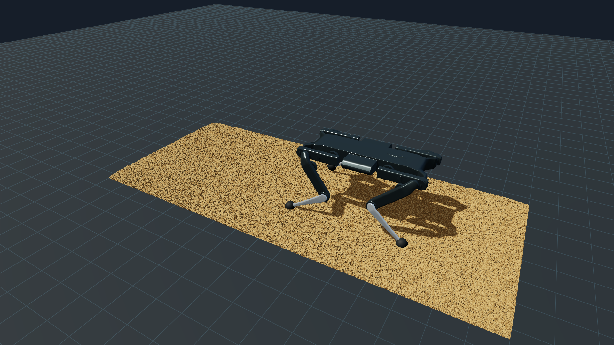
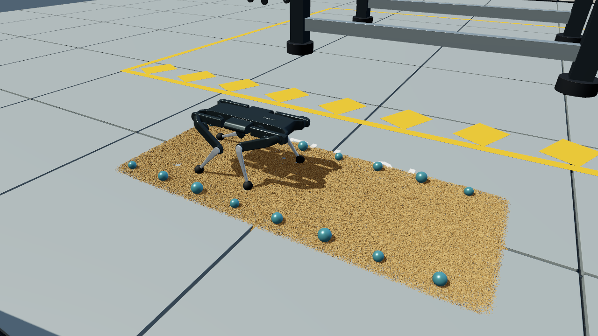

# Scenward Render

A native **Rust + wgpu** engine for recorded playback and live robotics/granular dynamics. Runs directly on Apple Metal: original robot mesh triangles, all **961,191 grains**, depth-correct spherical particles, shadow maps, material lighting and an interactive orbit camera.



This image was rendered by this Rust engine from numeric simulation caches. It is not an AI-generated image or a Blender screenshot.

## Live physics with Blender environments

[Run the live physics workflow](LIVE_PHYSICS.md). A fresh one-state seed feeds GPU integration, a Rust controller and native MuJoCo articulated dynamics. The original Blender lab exports **1,619 objects / 287,648 triangles**, with **48 dynamic props and 660 static collision proxies**. All **961,191 grains** and 50 µs steps are retained. Actual measured result: **2.4 simulated seconds in 75.84 wall seconds (0.0316× real time)**, plus 6.66 s initial settling. The full-detail physical real-time target is **not achieved**. Do not confuse the playback FPS below with live physics speed.



## What runs

- Native window and headless PNG capture, with 1x or 4x MSAA.
- Every recorded grain rendered analytically as a sphere, with true sphere depth and normal, rather than a flat point sprite. No grain decimation or coarser particle cache.
- Shared indexed Solo12 meshes with thirteen per-instance transforms, four foot pads and a ground plane.
- Directional lighting, roughness/metallic material response, tone mapping and 2048-pixel robot shadow maps with filtered sampling.
- Playback at the cache's recorded time scale; pause, frame stepping, orbital navigation and three camera views.
- Bounded numeric cache loading into reusable frame buffers. The multi-GB trajectory is not loaded into RAM at once.
- Reproducible headless GPU-completion benchmark; no silent software-adapter fallback.

This is a working specialized renderer, not yet a general scene editor or a replacement for Blender/Unreal. Recorded playback remains available. The optional live path uses Rust orchestration, a wgpu GPU grain solver and native MuJoCo for articulated/rigid dynamics. It does not implement learned policies or AI inference.

## Build and run

Install Rust from [rustup](https://rust-lang.org/tools/install/). The measured build used Rust 1.99.1 on an M4 Pro. From this directory:

```sh
cargo build --release --locked
cargo test --locked
cargo clippy --all-targets --locked -- -D warnings
```

First create a small numeric scene using the [Solo12 simulation instructions](../../examples/solo12_granular/). For example, from that example directory:

```sh
.venv/bin/python simulate.py --preset smoke --arch cpu --output runs/smoke
```

Then from this engine directory:

```sh
cargo run --release --locked --   --run ../../examples/solo12_granular/runs/smoke   --geometry ../../examples/solo12_granular/robot/preview-geometry.json
```

Use the `video` preset and Metal to reproduce the full scene on a supported Mac. For the measured full workload, retain 241 frames, 961,191 grains and the original controller; do not substitute smoke data when reporting performance.

| Control | Action |
| --- | --- |
| Space | Play / pause |
| Left mouse drag | Orbit |
| Scroll | Zoom |
| Left / right arrow | Pause and move one recorded frame |
| 1 or Home | Default camera |
| 2 | Low side camera |
| 3 | Overhead camera |
| Escape | Close |

Paused windows redraw on input rather than continuously consuming the GPU. A native macOS bundle can be created after building:

```sh
python3 package_macos.py --run /absolute/path/to/run   --geometry ../../examples/solo12_granular/robot/preview-geometry.json   --output '/absolute/path/Scenward Render.app'
```

By default it links the existing cache, so moving/deleting that cache breaks the link. `--copy-run` creates a larger self-contained local bundle. This locally built app is unsigned and not notarized. The CLI/Metal path and native window were exercised. Play/pause, frame stepping, side camera, orbit and zoom were checked through actual UI input. Finder launch stalled during local file opening on the test Mac; launching the same bundled executable from the terminal worked. If Finder launch stalls, use the CLI command above and resolve any macOS permission prompt normally. No macOS permission controls were changed.

## Capture and benchmark

Use a new output path; existing PNGs and benchmark reports are rejected.

```sh
./target/release/scenward-render --run /absolute/path/to/video   --geometry ../../examples/solo12_granular/robot/preview-geometry.json   --frame 240 --width 1920 --height 1080 --samples 4 --output frame.png

/usr/bin/time -l ./target/release/scenward-render --run /absolute/path/to/video   --geometry ../../examples/solo12_granular/robot/preview-geometry.json   --width 1920 --height 1080 --samples 4 --benchmark 120 --report benchmark.json
```

Measured on Apple M4 Pro (12 CPU cores, 16 GPU cores, 24 GB unified memory), Metal, five warmup frames then 120 sequential measured frames:

| Resolution / MSAA | Completed frames/s | Mean frame | p95 frame | Peak RSS | macOS peak footprint |
| --- | ---: | ---: | ---: | ---: | ---: |
| 1280 × 720 / 4x | 60.80 | 16.45 ms | 17.49 ms | 59.7 MB | 621.7 MB |
| 1920 × 1080 / 4x | 57.17 | 17.49 ms | 18.64 ms | 68.6 MB | 680.5 MB |

**These are recorded-cache playback measurements, including frame reads, validation, GPU upload, drawing and GPU completion. They exclude physics and PNG encoding.** This is one warmed sequential run per resolution, without vsync, on a normally used desktop. It does not establish cold-disk speed, live physics speed or parity with a path tracer. MB are decimal; RSS and macOS physical footprint are different OS metrics, not dedicated VRAM readings. See [raw frame samples](evidence/) and the separate [physics/analysis comparison](../../examples/solo12_granular/docs/performance.md).

## Architecture and decisions

`cache.rs` validates metadata, mesh indices and numeric NumPy arrays. It rejects object/pickle data, Fortran order, unsupported precision, oversized headers/shapes, truncated files, trailing data and nonfinite values. Frames are read directly into reusable float32 vectors. The source meshes and recorded transforms remain separate, allowing geometry reuse.

`renderer.rs` owns wgpu resources, shared mesh buffers, per-frame particle uploads, render targets, camera uniforms, depth and robot shadow passes. `scene.wgsl` intersects view rays with analytic spheres and writes the intersected depth. Closest-approach sphere math reduces cancellation at millimetre scale. The mesh path uses the original triangles. A native rendering layer was chosen because it removes Python from the display path without rewriting tested robot dynamics.

`main.rs` coordinates window events or headless rendering. GPU benchmarks wait for completed work before recording a duration. CLI requests select Metal on macOS and Vulkan/DX12 elsewhere. CPU/software adapters are rejected rather than used to produce misleading GPU timing.

## Threat model, provenance and limits

Only use trusted, locally generated numeric scene caches. The loader bounds input sizes and validates structures, but this is not a sandbox or an adversarial file-format security certification. No scripts embedded in assets are executed; there is no network service, telemetry or model download. A deliberately large but accepted scene can still exhaust available GPU memory. OS file permissions remain in force.

Original engine code is MIT under the [repository license](../../LICENSE). Robot geometry is Open Dynamic Robot Initiative Solo12, BSD-3-Clause; [provenance and attribution](../../examples/solo12_granular/THIRD_PARTY_NOTICES.md) remain unchanged. Caches come from this repository's classical physics model, with [documented shallow-layer soil limitations](../../examples/solo12_granular/README.md#interpretation-and-boundaries). No employer/client code or data is included.

Particles receive robot shadows but do not cast particle-to-particle shadow maps. Lighting is rasterized; it is not Cycles path tracing. Current imports are the Solo12 numeric schema and evaluated Blender environment meshes; general glTF/USD is not supported. Live collision/dynamics scope is documented separately. There is no material editor, general skeletal-animation system, asset browser or Unreal exporter in this Rust engine yet. Metal was measured on the Mac; native GPU execution on Windows NVIDIA/AMD and Linux remains unverified. Build-only CI is not a GPU validation claim.

Next useful milestones are general scene import with asset budgets, editable material/camera state and measured interoperability with the existing Blender/Unreal pipeline. Each needs its own end-to-end validation.
